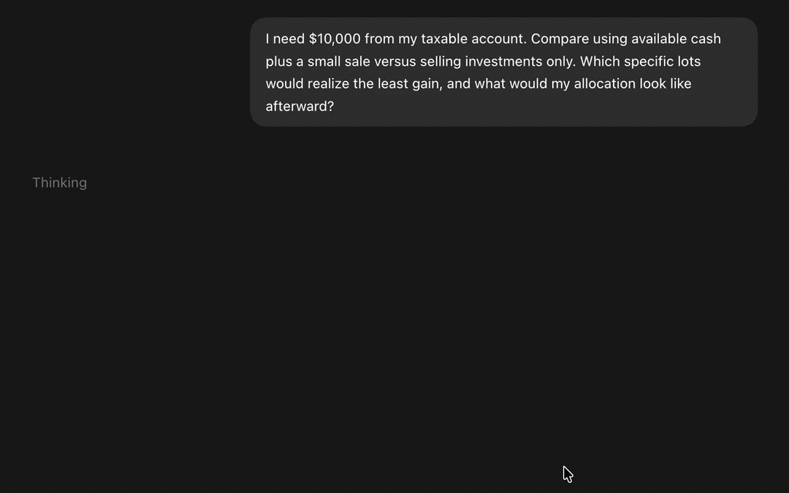

# Fidelity MCP

Connect a local AI assistant to your Fidelity portfolio through Chrome. Six read-only MCP tools expose accounts, balances, positions, tax lots, performance, and balance history.

Runs on your computer using your signed-in Chrome session. Fidelity credentials and cookies stay in Chrome. This is an unofficial integration; it cannot place orders or make transfers.



Real Codex interaction with portfolio figures substituted for privacy. No trades or withdrawals are executed.

## Quick start

You need **Node.js 24+**, **Chrome**, and a **local MCP client** that supports Streamable HTTP and OAuth. Supported platforms: macOS and Linux. Cloud clients cannot reach the local server.

Choose a connection method:

| Method              | Requirements                                                                 | Setup                                                     |
| ------------------- | ---------------------------------------------------------------------------- | --------------------------------------------------------- |
| Chrome debugging    | Chrome 144+; enable remote debugging and approve Chrome's connection prompt. | Steps below                                               |
| Companion extension | Chrome 120+; load the unpacked extension and register its native host.       | [Extension setup](docs/setup.md#setup-with-the-extension) |

For Chrome debugging:

1. Open `chrome://inspect/#remote-debugging` in Chrome and enable **Allow remote debugging for this browser instance**.
2. From the repository root, run:

   ```sh
   npm ci
   MCP_PORT=3444 npm run start:debugging
   ```

3. Click **Allow** in Chrome's connection prompt and leave the server running.
4. Add `http://127.0.0.1:3444/mcp` to your MCP client, then authenticate. Sign in and complete 2FA directly in Fidelity if prompted.

In the Codex desktop app, use **Settings → Plugins → MCPs → Add → Add MCP server**. Choose **Streamable HTTP**, enter the URL above, leave bearer-token and header fields empty, then select **Authenticate** with automatic OAuth client registration.

Chrome debugging grants browser-wide control to the local app. Connecting clients automatically receive portfolio read access after a working Fidelity session is confirmed. See [security and authorization](docs/security.md) for details.

For client requirements, extension installation, bridge switching, and connection fixes, see [setup and troubleshooting](docs/setup.md).

## Available tools

| Tool                           | Reads                                                                   |
| ------------------------------ | ----------------------------------------------------------------------- |
| `fidelity_list_accounts`       | Account names, types, masked suffixes, and opaque account IDs.          |
| `fidelity_get_account_balance` | Account values and available cash.                                      |
| `fidelity_get_positions`       | Holdings, quantities, prices, cost basis, and gain/loss when available. |
| `fidelity_get_tax_lots`        | Open tax lots for a held symbol in one account.                         |
| `fidelity_get_performance`     | Per-account returns for 1M, YTD, 1Y, and 3Y.                            |
| `fidelity_get_balance_history` | Dated account values for 1M, YTD, 1Y, and 3Y.                           |

List accounts first, then pass a returned `accountId` to select one account. Omitting it reads all visible supported brokerage accounts, including brokerage IRAs, for tools that support multiple accounts. Tax lots require both `accountId` and `symbol`.

Data may lag and reads are not an atomic snapshot. Balance changes include cash flows and are not investment returns. See the [tool reference](docs/tools.md) for parameters, result fields, and account-ID lifetimes.

## Development

```sh
npm run check
npx playwright install --with-deps chromium
npm test
```

E2E tests use synthetic Fidelity data and produce repeatable reports in `artifacts/`. The package is distributed from source and is not published to npm or the Chrome Web Store.

- [Development and verification](docs/development.md)
- [Architecture](docs/architecture.md)
- [Offline Fidelity API reference](docs/fidelity/README.md) — start here before adding adapters.
